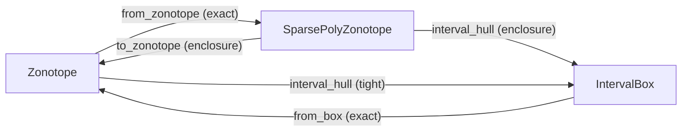

# polyzonotope

Sparse polynomial zonotopes (Kochdumper & Althoff, IEEE TAC 2021), zonotopes, and interval boxes, for set-based reachability analysis.

```text
PZ = { c + Σ_i (Π_k α_k^E[k,i]) G[:,i] + Σ_j β_j GI[:,j]  |  α, β ∈ [-1, 1] }
```

Dependent factors carry global `FactorId`s, so sets derived from the same uncertainty stay correlated.

| Operation | Exact? |
|---|---|
| `linear_map`, `translate`, `minkowski_sum`, `exact_plus`, `cartesian_product`, `compact`, `split` | exact |
| `interval_hull`, `to_zonotope` | sound enclosure |



## Usage

The parabola arc `{ (α, α²) | α ∈ [-1, 1] }` is a curved set that no zonotope represents exactly:

```rust
use nalgebra::{DMatrix, DVector};
use polyzonotope::{FactorId, SparsePolyZonotope};

let parabola = SparsePolyZonotope::new(
    DVector::from_vec(vec![0.0, 0.0]),
    DMatrix::identity(2, 2),                 // generators (1, 0) for α and (0, 1) for α²
    DMatrix::zeros(2, 0),                    // no independent generators
    DMatrix::from_row_slice(1, 2, &[1, 2]),  // exponents: α¹ and α²
    vec![FactorId::fresh()],
)?;

let hull = parabola.interval_hull();
assert_eq!((hull.0[0].lo, hull.0[0].hi), (-1.0, 1.0));
assert_eq!((hull.0[1].lo, hull.0[1].hi), (0.0, 1.0));
# Ok::<(), polyzonotope::ShapeError>(())
```

```bash
cargo test
cargo run --example quadratic_dependency   # {(α, α²)}: split, rotate and enclose the parabola
```

## MSRV

Rust 1.89. The MSRV is a signal, not a contract: it may rise in a minor release when a dependency or a language feature needs it.

## Verification
Property tests on random sets plus random samples of α and β:
- Every sampled point lies in `interval_hull`.
- `to_zonotope` is checked *by construction*: each point is reproduced with explicit coefficients in [-1, 1].
- Exact operations commute with evaluation.

## Soundness caveat
Arithmetic is plain `f64` for now. A sound mode with outward rounding (`inari`) is the top roadmap item, and is required before any formal-verification use.

## Roadmap
1. Sound interval mode; `quadratic_map`; order reduction (Girard, PCA); recursive split-based tight hulls.
2. Halfspace intersection checks, containment heuristics, `plotters` visualization.
3. Separate `polyzonotope-reach` crate: nonlinear reachability by conservative polynomialization (Althoff 2013), with a CORA cross-check.
4. Constrained polynomial zonotopes.

## License

Licensed under either of

- Apache License, Version 2.0 ([LICENSE-APACHE](https://github.com/sunsided/polyzonotope/blob/main/LICENSE-APACHE))
- MIT license ([LICENSE-MIT](https://github.com/sunsided/polyzonotope/blob/main/LICENSE-MIT))

at your option. The code under [`examples/`](https://github.com/sunsided/polyzonotope/tree/main/examples) is public domain ([CC0-1.0](https://github.com/sunsided/polyzonotope/blob/main/LICENSES/CC0-1.0.txt)), so you can copy it into anything.

Unless you explicitly state otherwise, any contribution intentionally submitted for inclusion in this work by you, as defined in the Apache-2.0 license, shall be dual licensed as above, without any additional terms or conditions.
