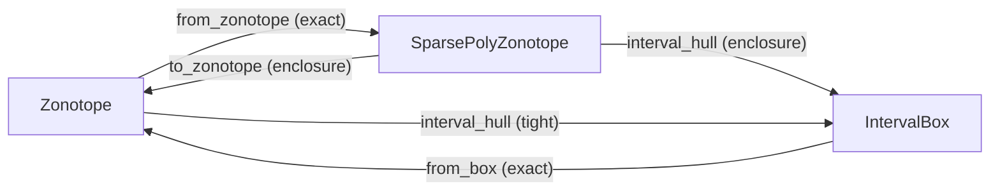

# polyzonotope

[](https://crates.io/crates/polyzonotope)
[](https://docs.rs/polyzonotope)
[](https://github.com/sunsided/polyzonotope/actions/workflows/ci.yml)
[](https://codecov.io/gh/sunsided/polyzonotope)
[](https://crates.io/crates/polyzonotope)
[](https://github.com/sunsided/polyzonotope#license)
[](https://github.com/rust-secure-code/safety-dance/)

Sparse polynomial zonotopes (Kochdumper & Althoff, IEEE TAC 2021), zonotopes, and interval boxes, for set-based reachability analysis.

## What is this for?

Say you have a drone, a robot arm or a cruise controller, and you don't know its state exactly: the sensors are a bit off, the payload is somewhere between 2 and 3 kg, and there is wind. A simulation with your best guess gives you one trajectory, but what you'd actually like to know is where the system could *possibly* end up, for every value the uncertain parts might take. If none of those places is the wall, you're fine; if one of them is, you'd rather find out on paper. That question is called reachability analysis, and the trick is to push a whole set of states through the model at once, instead of one point at a time.

This is the counterpart to sampling-based planners such as rapidly-exploring random trees (RRT). An RRT grows a tree of single trajectories until one of them reaches the goal, so it finds *a* way there, assuming everything happens exactly as computed. Reachability asks the opposite question: whether *any* of the possible outcomes is unsafe. The two combine well, since the planner proposes a path and the reachable set of the system following it shows that the path stays safe under the uncertainty.

How well that works depends on how the set is described. This crate has three descriptions, from coarse to fine:

- An interval box is one range per axis ("x between 1 and 2, y between 0 and 5"). It is cheap, but it loses shape quickly: rotate a box and you have to wrap the rotated box in a new, bigger one; repeated over many steps, this wrapping effect makes the box far larger than the set inside it.
- A zonotope is a center plus a few direction vectors, each stretched by some amount between -1 and 1. It can be skewed and stays exact under rotations, scaling and sums, so linear models don't blow it up.
- A sparse polynomial zonotope also allows those amounts to be multiplied with each other and raised to powers. That gives curved shapes (the parabola in the example below is one), and it keeps track of which uncertain quantity is which: two sets derived from the same sensor reading stay linked, instead of each pretending the other could take any value.

## The representation

```text
PZ = { c + Σ_i (Π_k α_k^E[k,i]) G[:,i] + Σ_j β_j GI[:,j]  |  α, β ∈ [-1, 1] }
```

Dependent factors carry global `FactorId`s, so sets derived from the same uncertainty stay correlated.

| Operation | Exact? |
|---|---|
| `linear_map`, `translate`, `minkowski_sum`, `exact_plus`, `cartesian_product`, `compact`, `split` | exact |
| `interval_hull`, `to_zonotope` | sound enclosure |

"Exact" means exact in real arithmetic. In `f64` the coefficients are rounded, unless you enable the `sound` feature (below).



## Usage

The parabola arc `{ (α, α²) | α ∈ [-1, 1] }` is a curved set that no zonotope represents exactly:

```rust
use nalgebra::{DMatrix, DVector};
use polyzonotope::{FactorId, SparsePolyZonotope};

let parabola = SparsePolyZonotope::new(
    DVector::from_vec(vec![0.0, 0.0]),
    DMatrix::identity(2, 2),                 // generators (1, 0) for α and (0, 1) for α²
    DMatrix::zeros(2, 0),                    // no independent generators
    DMatrix::from_row_slice(1, 2, &[1, 2]),  // exponents: α¹ and α²
    vec![FactorId::fresh()],
)?;

let hull = parabola.interval_hull();
assert_eq!((hull.0[0].lo, hull.0[0].hi), (-1.0, 1.0));
assert_eq!((hull.0[1].lo, hull.0[1].hi), (0.0, 1.0));
# Ok::<(), polyzonotope::ShapeError>(())
```

```bash
cargo test
cargo run --example quadratic_dependency   # {(α, α²)}: split, rotate and enclose the parabola
```

## `no_std`

The crate is `no_std` with `alloc`. The default `std` feature only switches monomial powers to `f64::powi`; without it, they are computed by repeated squaring:

```toml
polyzonotope = { version = "0.2", default-features = false }
```

Fresh `FactorId`s come from a global 64-bit counter in [`portable-atomic`](https://crates.io/crates/portable-atomic). Targets with 64-bit atomics, and those with 32-bit compare-and-swap such as Cortex-M3/M4, work as they are. Targets without any atomic read-modify-write, such as Cortex-M0 (`thumbv6m-none-eabi`) or `riscv32imc`, need portable-atomic's `critical-section` feature in your own `Cargo.toml`, plus a [`critical-section`](https://crates.io/crates/critical-section) implementation for the chip.

## MSRV

Rust 1.89. The MSRV is a signal, not a contract: it may rise in a minor release when a dependency or a language feature needs it.

## Verification
Property tests on random sets plus random samples of α and β:
- Every sampled point lies in `interval_hull`.
- `to_zonotope` is checked *by construction*: each point is reproduced with explicit coefficients in [-1, 1].
- Exact operations commute with evaluation.
- With `sound`, zero-tolerance checks compare results against error-free `TwoSum`/`TwoProduct` values, on inputs where plain `f64` rounds to the wrong side.

## Sound mode
By default, arithmetic is plain `f64`. An enclosure can then miss a point by a few ulps, so don't rely on it for formal verification. The `sound` feature fixes that with outward rounding from [`inari`](https://crates.io/crates/inari):

- `interval_hull` and `Interval` addition round their bounds outward, and `Zonotope::from_box` rounds its half widths up.
- Every operation listed as exact computes its new coefficients in interval arithmetic. It stores their midpoints and adds one axis-aligned generator for each dimension whose rounding error is nonzero: an independent generator for a `SparsePolyZonotope`, a plain generator for a `Zonotope`. The result then encloses the set real arithmetic would give.
- Every coefficient must be finite. A NaN or an infinity panics.

The error generators pile up over long chains of operations. Order reduction (on the roadmap) merges them again.

```toml
polyzonotope = { version = "0.2", features = ["sound"] }
```

inari needs `std` and runs only on x86-64 (Haswell or newer) and `AArch64`. On x86-64, set the target CPU in your `.cargo/config.toml`:

```toml
[target.'cfg(target_arch = "x86_64")']
rustflags = ["-C", "target-cpu=haswell"]
```

## Roadmap
1. `quadratic_map`; order reduction (Girard, PCA); recursive split-based tight hulls.
2. Halfspace intersection checks, containment heuristics, `plotters` visualization.
   An example that plans with an RRT and keeps an edge only if the reachable set along it misses every obstacle.
3. Separate `polyzonotope-reach` crate: nonlinear reachability by conservative polynomialization (Althoff 2013), with a CORA cross-check.
4. Constrained polynomial zonotopes.

## License

Licensed under either of

- Apache License, Version 2.0 ([LICENSE-APACHE](https://github.com/sunsided/polyzonotope/blob/main/LICENSE-APACHE))
- MIT license ([LICENSE-MIT](https://github.com/sunsided/polyzonotope/blob/main/LICENSE-MIT))

at your option. The code under [`examples/`](https://github.com/sunsided/polyzonotope/tree/main/examples) is public domain ([CC0-1.0](https://github.com/sunsided/polyzonotope/blob/main/LICENSES/CC0-1.0.txt)), so you can copy it into anything.

Unless you explicitly state otherwise, any contribution intentionally submitted for inclusion in this work by you, as defined in the Apache-2.0 license, shall be dual licensed as above, without any additional terms or conditions.
