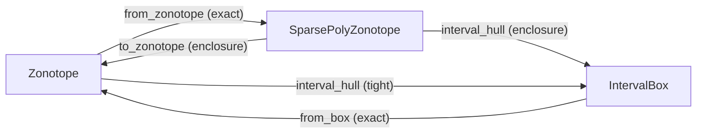

# polyzonotope

[](https://crates.io/crates/polyzonotope)
[](https://docs.rs/polyzonotope)
[](https://github.com/sunsided/polyzonotope/actions/workflows/ci.yml)
[](https://codecov.io/gh/sunsided/polyzonotope)
[](https://crates.io/crates/polyzonotope)
[](https://github.com/sunsided/polyzonotope#license)
[](https://github.com/rust-secure-code/safety-dance/)

Sparse polynomial zonotopes (Kochdumper & Althoff, IEEE TAC 2021), zonotopes, and interval boxes, for set-based reachability analysis.

## What is this for?

Say you have a drone, a robot arm or a cruise controller, and you don't know its state exactly: the sensors are a bit off, the payload is somewhere between 2 and 3 kg, and there is wind. A simulation with your best guess gives you one trajectory, but what you'd actually like to know is where the system could *possibly* end up, for every value the uncertain parts might take. If none of those places is the wall, you're fine; if one of them is, you'd rather find out on paper. That question is called reachability analysis, and the trick is to push a whole set of states through the model at once, instead of one point at a time.

This is the counterpart to sampling-based planners such as rapidly-exploring random trees (RRT). An RRT grows a tree of single trajectories until one of them reaches the goal, so it finds *a* way there, assuming everything happens exactly as computed. Reachability asks the opposite question: whether *any* of the possible outcomes is unsafe. The two combine well, since the planner proposes a path and the reachable set of the system following it shows that the path stays safe under the uncertainty.

How well that works depends on how the set is described. This crate has three descriptions, from coarse to fine:

- An interval box is one range per axis ("x between 1 and 2, y between 0 and 5"). It is cheap, but it loses shape quickly: rotate a box and you have to wrap the rotated box in a new, bigger one; repeated over many steps, this wrapping effect makes the box far larger than the set inside it.
- A zonotope is a center plus a few direction vectors, each stretched by some amount between -1 and 1. It can be skewed and stays exact under rotations, scaling and sums, so linear models don't blow it up.
- A sparse polynomial zonotope also allows those amounts to be multiplied with each other and raised to powers. That gives curved shapes (the parabola in the example below is one), and it keeps track of which uncertain quantity is which: two sets derived from the same sensor reading stay linked, instead of each pretending the other could take any value.

## The representation

```text
PZ = { c + Σ_i (Π_k α_k^E[k,i]) G[:,i] + Σ_j β_j GI[:,j]  |  α, β ∈ [-1, 1] }
```

Dependent factors carry global `FactorId`s, so sets derived from the same uncertainty stay correlated.

| Operation | Exact? |
|---|---|
| `linear_map`, `translate`, `minkowski_sum`, `exact_plus`, `cartesian_product`, `compact`, `split` | exact |
| `interval_hull`, `to_zonotope` | sound enclosure |
| `interval_hull_split(tol, max_splits)` | sound enclosure, tightened by branch and bound over `split` |
| `quadratic_map` | exact without independent generators; otherwise the monomials with a `β` are enclosed |
| `cubic_map` | exact without independent generators; otherwise the monomials with a `β` are enclosed |
| `reduce` (`Reduction::Girard`, `Reduction::Pca`), also on `Zonotope` | sound enclosure with at most `order · dim` generators |
| `interval_map(&IntervalMatrix)`, also on `Zonotope` | sound enclosure: the center map is exact, the radius becomes a box |
| `intersection(&polytope, max_splits)`, `containment(&polytope, max_splits)`, also on `Zonotope` | three-valued check: `Disjoint` / `Inside` are proofs, the other answers are not |
| `split_pieces(splits)`, `Zonotope::polygon` (2-D) | exact pieces; a polygon outline for drawing |

`ConstrainedPolyZonotope` (Kochdumper & Althoff 2023) restricts a sparse polynomial zonotope to the factor values where a polynomial constraint vanishes:

| Operation | Exact? |
|---|---|
| `linear_map`, `translate`, `minkowski_sum`, `intersection`, `intersect_halfspace`, `intersect_polytope` | exact |
| `interval_hull` (constraints ignored), `interval_hull_split` (infeasible pieces dropped) | sound enclosure |
| `proven_empty(max_splits)` | `true` is a proof; `false` means "not proven" |

"Exact" means exact in real arithmetic. In `f64` the coefficients are rounded, unless you enable the `sound` feature (below).



## Checking sets against obstacles

A `Polytope` is an intersection of `Halfspace`s `{ x | aᵀx <= d }`, and `Polytope::from_box` turns an `IntervalBox` into one. `intersection` answers whether a set meets a polytope, `containment` whether it lies inside. Both return three values, because an enclosure can prove a negative but not a positive:

- `Intersection::Disjoint` and `Containment::Inside` come from outer bounds, and are proofs. They are rigorous only with the `sound` feature; in plain `f64`, rounding can make them wrong by a few ulps at the boundary.
- `Intersection::Intersects` and `Containment::NotInside` rest on a witness point, evaluated in plain `f64`. Near the boundary they are not certified.
- `Unknown` means the split budget ran out, or the remaining piece has nothing left to split.

Where safety is at stake, accept only the proofs. Both checks split the set (`max_splits` in total) until they can decide. A zonotope against a single halfspace needs no splits. Points inside a zonotope, and one zonotope inside another, need linear programming and are not covered.

## Usage

The parabola arc `{ (α, α²) | α ∈ [-1, 1] }` is a curved set that no zonotope represents exactly:

```rust
use nalgebra::{DMatrix, DVector};
use polyzonotope::{FactorId, SparsePolyZonotope};

let parabola = SparsePolyZonotope::new(
    DVector::from_vec(vec![0.0, 0.0]),
    DMatrix::identity(2, 2),                 // generators (1, 0) for α and (0, 1) for α²
    DMatrix::zeros(2, 0),                    // no independent generators
    DMatrix::from_row_slice(1, 2, &[1, 2]),  // exponents: α¹ and α²
    vec![FactorId::fresh()],
)?;

let hull = parabola.interval_hull();
assert_eq!((hull.0[0].lo, hull.0[0].hi), (-1.0, 1.0));
assert_eq!((hull.0[1].lo, hull.0[1].hi), (0.0, 1.0));
# Ok::<(), polyzonotope::ShapeError>(())
```

```bash
cargo test
cargo run --example quadratic_dependency   # {(α, α²)}: split, rotate and enclose the parabola
cargo run --example plot_sets              # target/plots/sets.svg: the parabola, its enclosure and split pieces
cargo run --example rrt_reach              # target/plots/rrt.svg: an RRT that keeps only provably safe edges
```

## `no_std`

The crate is `no_std` with `alloc`. The default `std` feature only switches monomial powers to `f64::powi`; without it, they are computed by repeated squaring:

```toml
polyzonotope = { version = "0.2", default-features = false }
```

Fresh `FactorId`s come from a global 64-bit counter in [`portable-atomic`](https://crates.io/crates/portable-atomic). Targets with 64-bit atomics, and those with 32-bit compare-and-swap such as Cortex-M3/M4, work as they are. Targets without any atomic read-modify-write, such as Cortex-M0 (`thumbv6m-none-eabi`) or `riscv32imc`, need portable-atomic's `critical-section` feature in your own `Cargo.toml`, plus a [`critical-section`](https://crates.io/crates/critical-section) implementation for the chip.

## MSRV

Rust 1.89. The MSRV is a signal, not a contract: it may rise in a minor release when a dependency or a language feature needs it.

## Verification
Property tests on random sets plus random samples of α and β:
- Every sampled point lies in `interval_hull`.
- `to_zonotope` is checked *by construction*: each point is reproduced with explicit coefficients in [-1, 1].
- Exact operations commute with evaluation.
- With `sound`, zero-tolerance checks compare results against error-free `TwoSum`/`TwoProduct` values, on inputs where plain `f64` rounds to the wrong side.
- A cross-check against [CORA](https://github.com/TUMcps/CORA): `tests/cora/generate.m` runs the same operations in CORA and writes `tests/cora/reference.txt`, which `tests/it/cora.rs` compares against. The interval hulls of `interval_hull`, `quadratic_map`, `exact_plus`, Girard and PCA `reduce` agree to 1e-9, and so do the support functions of both reductions. `interval_hull_split` is at least as tight as CORA's split-based `interval`. Regenerate with `CORA_PATH=/path/to/CORA octave --no-gui --quiet tests/cora/generate.m`. Under Octave this needs the shims in `tests/cora/octave`. CORA itself is GPL-3.0 and is not part of this repository.

## Sound mode
By default, arithmetic is plain `f64`. An enclosure can then miss a point by a few ulps, so don't rely on it for formal verification. The `sound` feature fixes that with outward rounding from [`inari`](https://crates.io/crates/inari):

- `interval_hull` and `Interval` addition round their bounds outward, and `Zonotope::from_box` rounds its half widths up.
- Every operation listed as exact computes its new coefficients in interval arithmetic. It stores their midpoints and adds one axis-aligned generator for each dimension whose rounding error is nonzero: an independent generator for a `SparsePolyZonotope`, a plain generator for a `Zonotope`. The result then encloses the set real arithmetic would give.
- Every coefficient must be finite. This is a precondition, not a check: a NaN or an infinity panics once the arithmetic touches it, but coefficients an operation only copies pass through unchecked.

So under `sound`, the number of generators can grow after any exact operation, and so can the number of `β` values that positional `evaluate` expects. That is up to `2 · dim` per call, since `exact_plus` and `split` append one batch and their internal `compact` may append another. Cargo unifies features across the dependency graph, so read the count instead of assuming it: `independent_generators().ncols()` on a `SparsePolyZonotope`, `num_generators()` on a `Zonotope`. The error generators pile up over long chains of operations. `reduce` folds them back into a box.

```toml
polyzonotope = { version = "0.2", features = ["sound"] }
```

inari needs `std` and runs only on x86-64 (Haswell or newer) and `AArch64`. On x86-64, set the target CPU in your `.cargo/config.toml`:

```toml
[target.'cfg(target_arch = "x86_64")']
rustflags = ["-C", "target-cpu=haswell"]
```

## Roadmap
1. [`polyzonotope-reach`](https://github.com/sunsided/polyzonotope/tree/main/crates/polyzonotope-reach) (in this workspace): nonlinear reachability by conservative polynomialization (Althoff 2013), with a CORA cross-check of the reachable sets.

## License

Licensed under either of

- Apache License, Version 2.0 ([LICENSE-APACHE](https://github.com/sunsided/polyzonotope/blob/main/LICENSE-APACHE))
- MIT license ([LICENSE-MIT](https://github.com/sunsided/polyzonotope/blob/main/LICENSE-MIT))

at your option. The code under [`examples/`](https://github.com/sunsided/polyzonotope/tree/main/examples) is public domain ([CC0-1.0](https://github.com/sunsided/polyzonotope/blob/main/LICENSES/CC0-1.0.txt)), so you can copy it into anything.

Unless you explicitly state otherwise, any contribution intentionally submitted for inclusion in this work by you, as defined in the Apache-2.0 license, shall be dual licensed as above, without any additional terms or conditions.
